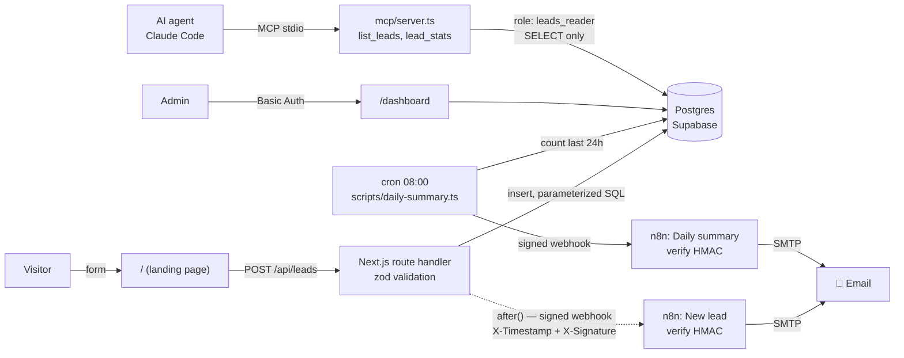

# lead-pipeline

[](https://github.com/HoriaaC/lead-pipeline/actions/workflows/ci.yml)

A small, end-to-end lead-generation pipeline: a landing form stores leads in Postgres,
a signed webhook triggers an n8n email, a daily cron sends a summary, a protected
dashboard lists the leads, and a **read-only MCP server** lets an AI agent query them.

Built in one weekend with Claude Code as a deliberately **thin but complete** slice:
every piece is small, but the whole path works, and every line is meant to be explainable.
See [`BUILD_LOG.md`](BUILD_LOG.md) for where the agent went wrong and how it was caught.

## Architecture



## Features

| Part | What it does | Where |
|---|---|---|
| Lead form + API | `POST /api/leads` → **201** created, **400** invalid JSON / validation errors (per field), **500** generic message (details only in server logs) | `app/page.tsx`, `app/lead-form.tsx`, `app/api/leads/route.ts` |
| Database | Plain SQL migrations with a tiny runner (advisory lock, one transaction per file) | `db/migrations/`, `db/migrate.ts` |
| Signed webhook | HMAC-SHA256 over `timestamp.body`, sent **after** the response; failure is logged, never fails the form | `lib/webhook.ts` |
| n8n workflows | Verify signature (timing-safe, 5-min window) → email, or **401** | `n8n/*.json` (exported copies) |
| Daily summary | Leads of the last 24h per source + latest 10, emailed via n8n; exit code 1 on failure | `scripts/daily-summary.ts`, [`RUNBOOK.md`](RUNBOOK.md) |
| Dashboard | Latest 50 leads, HTTP Basic Auth checked in `proxy.ts` **and** again in the page | `app/dashboard/`, `proxy.ts`, `lib/basic-auth.ts` |
| MCP server | `list_leads(limit, since?)`, `lead_stats(period)`; connects as a role that **cannot write** | `mcp/server.ts`, `.mcp.json` |

## Stack

- **Next.js 16** (App Router, Turbopack, `cacheComponents`) + **TypeScript** (`strict`)
- **PostgreSQL** on Supabase, accessed with **`pg`** and **plain parameterized SQL** — no ORM
- **zod** at every boundary: HTTP body, env vars, MCP tool input
- **n8n Cloud** for the email automations
- **MCP** server with the official `@modelcontextprotocol/sdk`
- Deploy target: Ubuntu 24.04 VPS, Nginx, Let's Encrypt, pm2 *(planned, not deployed yet)*

## Key decisions

- **Plain SQL, no ORM.** One table, a handful of queries: SQL is shorter than any ORM setup
  and shows exactly what runs. All queries use `$1, $2…` parameters, never string building.
- **Verified TLS to Supabase.** `lib/pg-pool.ts` checks the server certificate against
  Supabase's CA (`certs/supabase-ca.crt`) instead of `rejectUnauthorized: false`.
- **Webhook signed with a timestamp.** The signature covers `timestamp + "." + rawBody`,
  so a captured request can't be replayed after 5 minutes. The body is serialized **once**
  and those exact bytes are signed and sent; n8n verifies the **raw** bytes, not its parsed JSON.
- **The form never waits for n8n.** The webhook runs in `after()` (sent once the 201 is
  out), with a 5s timeout. If n8n is down the visitor still gets 201; the server logs
  `[webhook] lead N: …` (id only — the payload is personal data).
- **Webhook secret lives in an n8n credential**, not in the workflow: n8n Cloud has no
  `.env`, and credentials are encrypted and excluded from exports.
- **Defence in depth on the dashboard.** `proxy.ts` blocks unauthenticated requests, and
  the page re-checks, so a matcher mistake or proxy bypass doesn't expose data. Credentials
  are compared in constant time.
- **Read-only by construction for the agent.** The MCP server connects as `leads_reader`
  (`SELECT` on `leads` only), so even a misbehaving tool or prompt can't modify data.
  Because RLS is enabled on `leads`, the role also needs an explicit select policy —
  otherwise it would silently see 0 rows.
- **Daily summary is sent even with 0 leads** — a daily email proves the cron is alive;
  silence would be ambiguous.
- **Env validated at startup** (`lib/env.ts`): the app crashes early with the list of
  missing/invalid variable *names*, never their values.

## Local setup

Requirements: Node.js **22+** (for `--env-file` and test globs; CI uses 24), a Supabase project, and (optionally)
an n8n instance for the emails.

```bash
npm install
cp .env.example .env          # fill in the values; comments in the file explain each one
npm run db:check              # connection smoke test
npm run db:migrate            # create tables + read-only role (safe to re-run)
npm run db:seed               # optional: reset 14 demo leads (@example.com)
npm run dev                   # http://localhost:3000
```

For the MCP server, set a password for the read-only role once (SQL editor, as owner)
and put the connection string in `MCP_DATABASE_URL`:

```sql
alter role leads_reader password '<random password>';
```

### Environment variables

| Variable | Used by | Notes |
|---|---|---|
| `DATABASE_URL` | app, scripts | Supabase Session pooler URI (table owner) |
| `DASHBOARD_USER` / `DASHBOARD_PASSWORD` | `/dashboard` | password ≥ 12 chars |
| `N8N_WEBHOOK_URL` | new-lead webhook | n8n production webhook URL |
| `N8N_SUMMARY_WEBHOOK_URL` | daily summary | second n8n workflow |
| `WEBHOOK_SECRET` | both webhooks | ≥ 32 chars; same value as the n8n Crypto credential |
| `MCP_DATABASE_URL` | MCP server | `leads_reader.PROJECT_REF` user, read-only |

### Commands

| Command | |
|---|---|
| `npm run dev` | dev server |
| `npm run build && npm start` | production build + server |
| `npm run lint` / `npx tsc --noEmit` | lint / type-check |
| `npm test` | unit tests (`node:test`, no DB or network needed) |
| `npm run db:check` / `db:migrate` / `db:seed` | database |
| `npm run summary` (`-- --dry-run`) | send (or just print) the daily summary |
| `npm run mcp` | start the MCP server on stdio |

## Try it

```bash
# 201 — created, triggers the email
curl -i -X POST localhost:3000/api/leads -H 'content-type: application/json' \
  -d '{"name":"Ana","email":"ana@example.com","company":"Acme"}'

# 400 — per-field validation errors
curl -i -X POST localhost:3000/api/leads -H 'content-type: application/json' \
  -d '{"name":"","email":"not-an-email"}'

# 401 without credentials, 200 with them
curl -i localhost:3000/dashboard
curl -i -u "$DASHBOARD_USER:$DASHBOARD_PASSWORD" localhost:3000/dashboard
```

**MCP:** the repo's `.mcp.json` registers the server for Claude Code. Open the project,
approve the `lead-pipeline` server, then ask e.g. *"How many leads came in during the last
7 days, and from which sources?"* — the agent calls `lead_stats` and answers from the database.

## Project layout

```
app/                  landing page + form, api/leads route, dashboard
lib/                  env (zod), pg pool, leads queries, webhook signing, basic auth
db/                   migrations, migration runner, seed, connection check
scripts/              daily-summary.ts (cron)
mcp/                  read-only MCP server
n8n/                  exported n8n workflows (no secrets; emails replaced)
proxy.ts              Basic Auth for /dashboard (Next 16's name for middleware)
CLAUDE.md, .claude/   instructions + project skills used by Claude Code
RUNBOOK.md            operations: cron, troubleshooting
BUILD_LOG.md          honest log of agent mistakes and how they were caught
```

## Status

Roadmap steps 1–6 are done: database, form + API, dashboard, signed webhook, daily
summary, MCP server, plus unit tests and CI.

**Not deployed yet.** The app runs locally against the hosted pieces (Supabase, n8n Cloud).
The planned target is an Ubuntu 24.04 VPS with Nginx as reverse proxy, Let's Encrypt
(certbot) for TLS, pm2 for the Next.js process, and the cron job from
[`RUNBOOK.md`](RUNBOOK.md). Nothing in the code assumes a specific host: `after()` and
`proxy.ts` run on a self-hosted Node server, and all configuration comes from `.env`.
